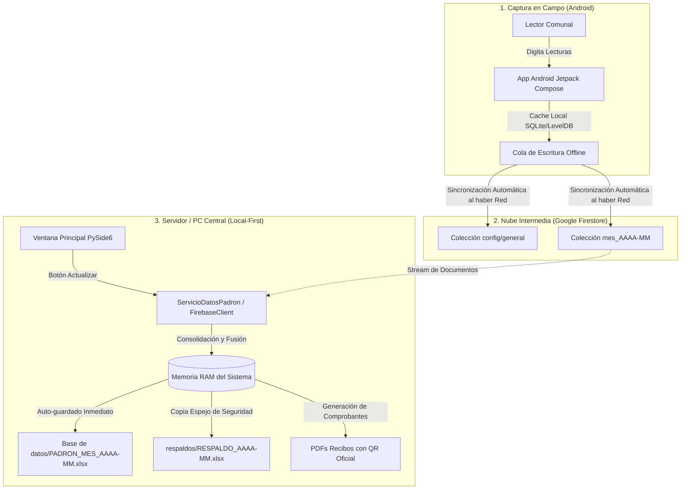

# Documentación Técnica de Base de Datos y Flujo de Información
## Sistema de Facturación y Cobranza — CAAPD Ispacas

Este documento detalla la arquitectura de persistencia del sistema: el ciclo de vida del dato desde la captura en campo con el teléfono móvil Android, el almacenamiento intermedio en la nube con **Google Firebase Firestore**, la descarga y consolidación local en la PC mediante archivos **Microsoft Excel (`.xlsx`)**, el propósito riguroso de cada columna y la lógica operativa del campo fundamental **`PAGO` (`SI` / `NO`)**.

---

## 1. Arquitectura y Filosofía del Modelo de Datos

El sistema opera bajo un enfoque **Híbrido y Local-First con Nube Satelital**:



### ¿Por qué Excel como Base de Datos Maestra en la PC?
1. **Soberanía y Portabilidad Comunal:** La Junta Administradora CAAPD opera en un contexto donde el acceso a internet puede ser intermitente. Los directivos no requieren instalar servidores complejos (PostgreSQL o MySQL). Un archivo `.xlsx` puede abrirse en cualquier computadora, auditarse en Excel y transportarse en una memoria USB.
2. **Respaldo Integral 100% Autónomo:** El archivo Excel contiene una estructura de doble capa: hojas legibles para humanos con formatos contables por sector, y un bloque técnico de columnas grises que almacena el 100% de los datos crudos para reconstruir el sistema en caso de desastre.

---

## 2. Flujo del Dato: Del Celular a Firebase y a la PC

### Paso 1: Captura en el Celular (App Android)
- **Tecnología:** Kotlin, Jetpack Compose, Firebase Firestore SDK.
- **Modo Offline:** La app Android está configurada con persistencia local (`Source.CACHE`). El lector puede adentrarse en quebradas o sectores sin cobertura móvil.
- **Acción del Lector:**
  1. Selecciona el sector asignado.
  2. Busca al abonado por nombre o número de conexión.
  3. Ingresa la **Lectura Actual** del medidor, selecciona una **Novedad** del catálogo (`NORMAL`, `MEDIDOR_DANADO`, `CAMBIO_MEDIDOR`, `CASA_CERRADA`, etc.) y escribe una nota opcional.
  4. Al presionar "Guardar Lectura", se ejecuta en Kotlin:
     ```kotlin
     db.collection("mes_$periodo").document(idUsuario).update(
         mapOf(
             "medidores" to medidores.map { it.aMap() },
             "consumo_total_m3" to consumoTotal
         )
     )
     ```
     *(Nótese que no se utiliza `.await()`. El SDK nativo de Firebase confirma inmediatamente en la memoria del teléfono y transmite la mutación a la nube en segundo plano en cuanto detecta señal 3G/4G/WiFi).*

### Paso 2: Persistencia en Google Firebase Firestore
En Firestore residen tres colecciones estructurales:
1. `config/general`: Contiene parámetros de periodos (`mes_actual`), tarifas por categoría (`A`, `B`, `C`), catálogo de novedades y el último número correlativo de recibo emitido.
2. `usuarios/{id_usuario}`: El padrón permanente de abonados con datos personales y números de serie de medidores asignados.
3. `mes_AAAA-MM/{id_usuario}`: Los documentos específicos del mes facturado. Cada documento almacena:
   - Identificación del usuario (`id_usuario`, `nro_conexion`, `nombre`, `sector`, `direccion`).
   - Arreglo de medidores (`medidores`): cada uno con `lectura_anterior`, `lectura_actual`, `fecha_lectura`, `novedad`, `nota`, `registrado_por` y `estado_lectura` (`LEIDO` o `PENDIENTE`).
   - Datos de facturación calculados (`consumo_total_m3`, `total_a_pagar`, `monto_pagado`, `deuda_anterior`, `nro_recibo`, `fecha_pago`).

### Paso 3: Sincronización y Respaldo a la PC
1. El tesorero o administrador en la oficina de CAAPD abre el software de escritorio.
2. Presiona el botón **"Actualizar"** (o en la barra de menú: **"Descargar lecturas de Firebase"**).
3. Se dispara el método `sincronizar_desde_firebase()` en `ServicioDatosPadron`:
   - Descarga un flujo continuo (`stream()`) de todos los documentos del mes en Firestore.
   - Cruza cada documento por `id_usuario` con el padrón local cargado en memoria.
   - Actualiza lecturas, novedades y fechas registradas por el celular.
4. Finalizado el cruce, se invoca de manera automática `guardar_en_respaldo_local()`:
   - Se compila y sobrescribe el archivo maestro en:
     `Base de datos/PADRON_MES_AAAA-MM.xlsx`
   - Se genera una copia espejo en:
     `respaldos/RESPALDO_AAAA-MM.xlsx`

---

## 3. Estructura y Significado de Columnas en el Excel Maestro

El archivo Excel generado (`PADRON_MES_AAAA-MM.xlsx` o `RESPALDO_AAAA-MM.xlsx`) contiene un libro de trabajo con cuatro tipos de hojas:
1. **`LEEME`**: Hoja de cabecera, auditoría y checksum de seguridad.
2. **Hojas por Sector** (`CENTRO`, `SAN MARTIN`, `MIRAFLORES`, etc.): Planillas operativas de lectura, facturación y cobro.
3. **`USUARIOS`**: Padrón maestro completo de abonados.
4. **`CONFIG`**: Parámetros globales y serialización JSON del sistema.

---

### A. Hoja `LEEME` (Control de Integridad)

Diseñada para certificar que el archivo no ha sido adulterado o dañado.

| Celda | Parámetro | Propósito y Formato |
| :--- | :--- | :--- |
| **B5** | Versión del Formato | `2.0` (Define el estándar de columnas compatibles). |
| **B6** | Fecha de Generación | Marca temporal exacta de compilación (`AAAA-MM-DD HH:MM:SS`). |
| **B7** | Periodo Respaldado | Identificador del mes fiscal (ej. `2026-10`). |
| **B8** | Estado del Mes | `ABIERTO` (en proceso de lecturas) o `FACTURADO` (con recibos emitidos). |
| **B9** | Total Usuarios Padrón | Conteo numérico de abonados en el padrón activo. |
| **B10**| Total Documentos Mes | Conteo de abonados facturados en este periodo. |
| **B11**| Suma Total a Pagar (S/.)| Importe monetario consolidado a cobrar (`S/. #,##0.00`). |
| **B12**| **Checksum Verificación** | Huella digital de integridad con la fórmula `{Total_Docs}_{Suma_Total:.2f}` (ej. `1248_24560.80`). |

> [!NOTE]
> Cuando se restaura un respaldo en la PC mediante `scripts/restaurar_excel.py`, el sistema calcula la suma y el conteo fila por fila de las hojas y los compara contra el **Checksum**. Si difieren, advierte al operador sobre una posible corrupción o manipulación manual del archivo.

---

### B. Hojas por Sector: Bloque Visible (Columnas A hasta P)

Cada hoja representa un sector territorial de Ispacas. Las filas corresponden a cada abonado. En usuarios con múltiples medidores, se generan filas secundarias vinculadas para cada medidor adicional.

| Columna | Nombre de Cabecera | Tipo de Dato | Origen del Dato | Descripción, Propósito y Reglas |
| :---: | :--- | :---: | :--- | :--- |
| **A** | `Fecha Lect.` | Texto (`AAAA-MM-DD`) | App Móvil | Fecha en la que el lector tomó la lectura física en el predio. Si está pendiente, permanece en blanco. |
| **B** | `Conexión` | Texto | Padrón Maestro | Código identificador de la conexión domiciliaria (ej. `000142`). Siempre normalizado con ceros a la izquierda. |
| **C** | `N° Medidor` | Texto | Padrón Maestro | Número de serie físico troquelado en la carátula del medidor (ej. `000100` o `22392996`). |
| **D** | `Titular / Beneficiario`| Texto | Padrón Maestro | Apellidos y nombres completos del abonado en mayúsculas. |
| **E** | `Dirección` | Texto | Padrón Maestro | Calle, pasaje, lote o referencia del predio donde se ubica la acometida. |
| **F** | `Lect. Anterior` | Entero ($m^3$) | Cierre Mes Previo | Lectura con la que cerró el mes anterior. Base para calcular el consumo actual. |
| **G** | `Lect. Actual` | Entero ($m^3$) | App Móvil / Manual | Nueva lectura registrada en campo. Debe ser mayor o igual a la anterior salvo reemplazo de medidor. |
| **H** | `Consumo (m³)` | Entero o Fórmula | Calculado | Consumo mensual del medidor. En Excel se inyecta la fórmula: `=IF(ISBLANK(G4),"",G4-F4)`. |
| **I** | `Observación` | Texto | App Móvil / Manual | Novedad técnica registrada en campo: `NORMAL`, `MEDIDOR_DANADO`, `CAMBIO_MEDIDOR`, `CASA_CERRADA`, `FUGA_VISIBLE`, etc. |
| **J** | `Nota` | Texto libre | App Móvil / Manual | Comentario complementario ingresado por el lector (ej. "Perro bravo en puerta", "Tapa enterrada bajo desmonte"). |
| **K** | `N° Recibo` | Texto (9 dígitos) | Generador Recibos | Correlativo único de comprobante asignado durante la facturación (ej. `000058391`). |
| **L** | `Deuda Ant. (S/.)` | Decimal (`0.00`) | Módulo de Cobros | Saldo pendiente acumulado proveniente de meses anteriores no cancelados. |
| **M** | `Deuda Actual (S/.)` | Decimal (`0.00`) | Motor de Cálculo | Importe facturado correspondiente exclusivamente al consumo y servicios del mes en curso. |
| **N** | `Meses` | Entero | Motor de Cálculo | Número de meses continuos adeudados (1 = mes corriente, 2 = 1 mes vencido, 3 o más = apto para corte). |
| **O** | **`Pago`** | Texto (`SI` / `NO`) | Tesorería / Excel | **Indicador de estado de cancelación.** Solo admite los valores `SI` o `NO` (ver detalle en la Sección 4). |
| **P** | `Fecha Pago` | Texto (`AAAA-MM-DD`) | Tesorería | Fecha en la que el usuario abonó el importe en ventanilla o banco. En blanco si `Pago` es `NO`. |

---

### C. Hojas por Sector: Bloque Técnico Gris de Restauración (Columnas Q hasta AC)

Ubicado a la derecha de la planilla visible (a partir de la columna 17), tiene fondo gris claro (`#F1F5F9`). **Permite reconstruir el 100% de la base de datos sin pérdida de decimales ni desconfiguración de tarifas.**

| Columna | Nombre de Cabecera | Tipo de Dato | Propósito Técnico |
| :---: | :--- | :---: | :--- |
| **Q** | `ID Usuario` | Texto | DNI o llave primaria irrepetible del abonado en la base de datos. Imprescindible para el cruce de datos. |
| **R** | `Fecha Anterior` | Texto (`AAAA-MM-DD`) | Fecha exacta en la que se tomó la lectura del mes previo. |
| **S** | `Consumo Anterior` | Entero | Volumen consumido en el mes anterior ($m^3$). |
| **T** | `Estado Lectura` | Texto | `LEIDO`, `PENDIENTE` o `SIN_ACCESO`. Permite saber si el lector visitó el predio. |
| **U** | `Registrado Por` | Texto | Nombre, correo o UID del lector móvil que subió la lectura. Auditoría de campo. |
| **V** | `Categoría` | Texto (`A`, `B`, `C`) | Código tarifario asignado (Doméstica, Comercial, Estatal, etc.). |
| **W** | `Historial m³` | Texto (CSV) | Cadena separada por comas con los últimos 6 consumos (ej. `12,14,10,15,13,11`). Se utiliza para graficar las barras históricas en el recibo PDF sin consultar periodos antiguos. |
| **X** | `Consumo Total m³` | Entero | Sumatoria de consumos cuando un usuario posee más de un medidor en la misma conexión. |
| **Y** | `Monto Agua` | Decimal | Subtotal liquidado por volumen de agua potable según tarifa escalonada. |
| **Z** | `Monto Desagüe` | Decimal | Subtotal liquidado por mantenimiento de alcantarillado. |
| **AA**| `Cargo Fijo` | Decimal | Cargo mensual fijo por mantenimiento de conexión (típicamente `S/. 1.50`). |
| **AB**| `IGV` | Decimal | Impuesto General a las Ventas calculado (si la categoría lo exige). |
| **AC**| `Redondeo` | Decimal | Ajuste compensatorio de céntimos para facilitar cobro exacto en efectivo. |

---

### D. Hoja `USUARIOS` (Padrón Maestro)

Mantiene la base de clientes del servicio de saneamiento:
- `id_usuario`: DNI o código único.
- `nro_conexion`: Identificador visual de acometida.
- `nombre`: Nombre del titular o beneficiario.
- `sector`: Barrio o zona geográfica.
- `direccion`: Domicilio fiscal o predial.
- `codigo_categoria`: Categoría tarifaria asignada.
- `activo`: `SI` o `NO` (determina si se incluye en la facturación mensual).
- `medidores`: Lista de números de medidor asociados separados por comas.

---

### E. Hoja `CONFIG` (Gobernanza del Sistema)

- **Celda `A4`:** Contiene la serialización **JSON Cruda Completa** de la configuración del sistema (tarifas, rangos de m³, cargos fijos, reglas de mora y datos de la junta). Esto permite que el software reconstruya la configuración original exacta con solo cargar el Excel.
- **Columnas C y D:** Tablas auxiliares legibles con los parámetros de control: `ultimo_recibo`, `mes_actual.periodo`, `mes_actual.estado`, `fecha_emision` y `fecha_vencimiento`.

---

## 4. Profundización en la Columna `PAGO`: Lógica de "SI" y "NO"

### A. La Regla de Negocio: "Todo o Nada"
En la gestión de saneamiento rural y comunal de CAAPD Ispacas, **no existen pagos parciales ni fraccionados de un recibo mensual**:
- Si un recibo totaliza `S/. 24.50`, el abonado cancela la totalidad de la deuda o permanece con estado adeudado.
- Admitir centavos o importes parciales generaría descuadres contables en la asamblea comunal y ambigüedades respecto al derecho de corte al tercer mes de mora.
- Por tanto, el estado financiero de cada abonado para un periodo dado es estrictamente binario: **`SI`** (cancelado) o **`NO`** (pendiente).

---

### B. Cómo se Escribe el Dato hacia el Excel (`generar_respaldo_excel`)

Cuando el sistema exporta los datos desde la memoria a la columna **O** (`Pago`) del Excel, se aplica la siguiente regla en Python (`respaldo_excel.py`):

```python
# Extracción de valores monetarios
tot_pagar = float(doc.get("total_a_pagar") or 0.0)
m_pagado  = float(doc.get("monto_pagado") or 0.0)

# Evaluación del indicador de pago
if "pago" in doc and str(doc["pago"]).strip().upper() in ("SI", "NO"):
    pago_str = str(doc["pago"]).strip().upper()
else:
    # Si monto_pagado cubre el total y el total es mayor a cero -> SI, de lo contrario -> NO
    pago_str = "SI" if (m_pagado >= tot_pagar and tot_pagar > 0) else "NO"

# Asignación física a la celda del Excel (Columna 15 = O)
ws_sec.cell(row=fila_act, column=15, value=pago_str).alignment = Alignment(horizontal="center")
```

**Comportamiento en la celda:**
- Si el usuario abonó su recibo: Se escribe el texto literal `"SI"` centrado.
- Si el usuario no ha cancelado: Se escribe el texto literal `"NO"` centrado.
- Si el total a pagar es `0.00` (caso especial de predio exonerado o sin consumo con cargo condonado): Permanece en `"NO"` salvo que se marque expresamente como cancelado.

---

### C. Cómo se Lee el Dato desde el Excel (`leer_respaldo_excel` y `datos_padron.py`)

Al importar un archivo Excel externo, una planilla editada por tesorería o un respaldo histórico, el sistema parsea de forma tolerante a fallos la columna `Pago`:

```python
# Lectura de la celda en la fila r
val_celda = ws_sec.cell(row=r, column=col_pago).value
p_val = str(val_celda or "").strip().upper()

if p_val in ("SI", "1", "TRUE", "PAGADO"):
    # CASO 1: RECIBO PAGADO
    mes_doc["pago"] = "SI"
    mes_doc["monto_pagado"] = mes_doc["total_a_pagar"]  # Asume el 100% pagado
    mes_doc["meses_adeudados"] = 0                      # Se restablece el contador de morosidad
    if not mes_doc.get("fecha_pago"):
        mes_doc["fecha_pago"] = datetime.date.today().isoformat()

else:
    # CASO 2: RECIBO PENDIENTE
    mes_doc["pago"] = "NO"
    mes_doc["monto_pagado"] = 0.0                       # Cero soles abonados
    mes_doc["fecha_pago"] = None                        # No existe fecha de cancelación
```

#### Soporte para plantillas heredadas con importes numéricos:
Si la columna en lugar de decir `"SI"` o `"NO"` contiene un número (ej. columna `monto_pagado` con `17.50`):
1. El sistema convierte el valor a flotante: `m_pagado = float(val)`.
2. Evalúa si `m_pagado >= total_a_pagar and total_a_pagar > 0`.
3. Si se cumple, lo promueve a `pago = "SI"`; si es menor o `0.0`, lo fija en `pago = "NO"`.

---

### D. Efectos del Estado `PAGO` en el Resto del Sistema

| Módulo o Proceso | Comportamiento si `PAGO == "SI"` | Comportamiento si `PAGO == "NO"` |
| :--- | :--- | :--- |
| **Módulo de Cobranza** | Aparece en la pestaña **"Historial de Cobros"** con botón disponible para *Anular Cobro* o *Reimprimir Comprobante*. | Aparece en la pestaña **"Cobrar en Ventanilla"** listo para registrar su pago con emisión de ticket. |
| **Generador de Recibos PDF** | El comprobante se imprime con el sello de agua **"CANCELADO"**, fecha de pago y no exhibe recargos por mora. | Se emite como **"RECIBO PENDIENTE"**, mostrando la fecha límite de pago y el detalle de mora si corresponde. |
| **Lista de Cortes de Servicio** | El usuario queda automáticamente descartado de cualquier orden de corte. | Si `meses_adeudados >= 3`, el sistema lo incluye en la lista roja de **"Corte de Servicio Inmediato"**. |
| **Estadísticas del Dashboard** | Suma al indicador **"Recaudación Total (S/.)"** y descuenta de la cartera vencida. | Suma al indicador **"Monto por Cobrar (S/.)"** y eleva la tasa de morosidad global. |
| **Cierre de Mes y Traspaso** | El usuario inicia el siguiente periodo con **Deuda Anterior = S/. 0.00** y **Meses = 1**. | El total adeudado se arrastra al siguiente mes como **Deuda Anterior** y el contador suma: **Meses = Meses + 1**. |

---

## 5. Resumen del Flujo de Sincronización Bidireccional

```
┌─────────────────────────────────────────────────────────┐
│                    CELULAR ANDROID                      │
│ - Toma lecturas en campo offline                        │
│ - Guarda en SQLite/LevelDB local                        │
│ - Sube a Firestore cuando hay cobertura 3G/4G/WiFi      │
└────────────────────────────┬────────────────────────────┘
                             │ (HTTPS / Firestore SDK)
                             ▼
┌─────────────────────────────────────────────────────────┐
│                 NUBE GOOGLE FIRESTORE                   │
│ - Colección: mes_2026-10                                │
│ - Documentos: {id_usuario} con medidores y novedades    │
└────────────────────────────┬────────────────────────────┘
                             │
                             │ (Botón 'Actualizar' en PC)
                             ▼
┌─────────────────────────────────────────────────────────┐
│                     PC FACTURACIÓN                      │
│ 1. Descarga stream Firestore con firebase_client.py     │
│ 2. Cruza con padrón de usuarios en memoria RAM          │
│ 3. Calcula consumos, tarifas escalonadas y moras        │
│ 4. Escribe archivo: Base de datos/PADRON_MES_2026-10.xlsx│
│ 5. Escribe espejo:  respaldos/RESPALDO_2026-10.xlsx     │
│ 6. Cobra en ventanilla y conmuta PAGO = 'SI' / 'NO'     │
│ 7. Si no hay internet, guarda cobro en cola_offline.json│
│ 8. Genera recibos oficiales en PDF con código QR        │
└─────────────────────────────────────────────────────────┘
```

Con esta arquitectura, la asociación de saneamiento CAAPD Ispacas garantiza que ningún dato se pierda en campo, que las lecturas lleguen seguras a la nube y que la administración central mantenga el control contable soberano en sus propios archivos de Excel en la PC.
