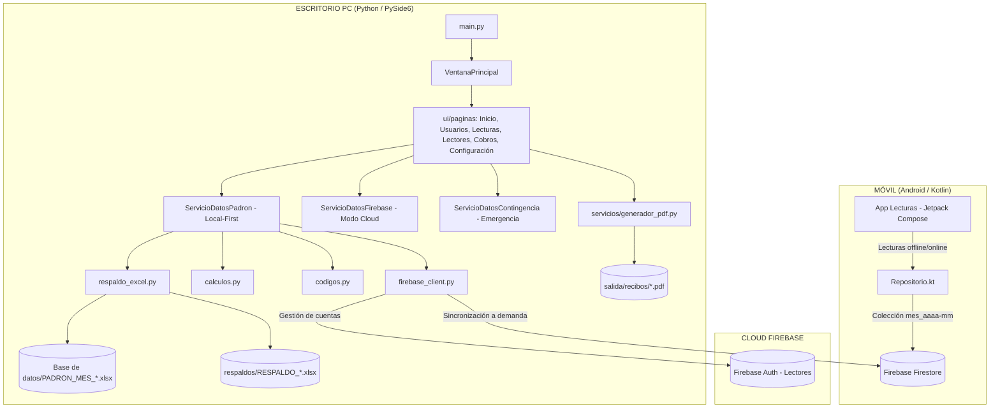
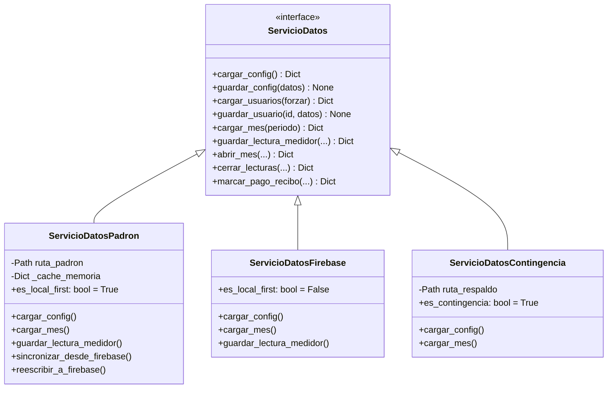
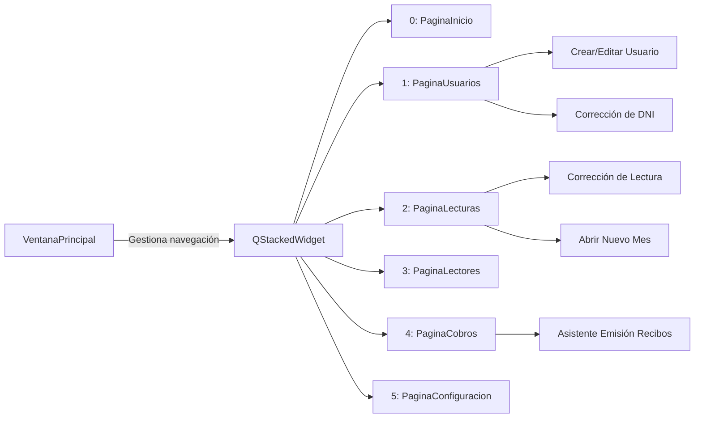

# CAAPD Ispacas — Explicación de Arquitectura e Interconexión de Clases

Este documento detalla la arquitectura completa del sistema de facturación de agua potable **CAAPD Ispacas**, explicando cómo interactúan el software de escritorio (PySide6 / Python), el servicio en la nube (Google Cloud Firebase Firestore y Auth), el motor de respaldos en Excel y la aplicación móvil de lectura (Android / Jetpack Compose).

---

## 1. Visión General de la Arquitectura

El sistema está diseñado bajo el principio **Local-First con Sincronización Cloud Asíncrona**:
- **Cero latencia en PC:** La interfaz de escritorio opera leyendo y escribiendo directamente en la base de datos local en Excel (`Base de datos/PADRON_MES_aaaa-mm.xlsx`), lo que garantiza arranques inmediatos (< 1 segundo) y 0 lecturas a la nube en la operativa habitual.
- **Sincronización Cloud a demanda:** Cuando los lectores toman lecturas en el campo con celulares Android, las lecturas suben a Firestore. La secretaria en la PC hace clic en *Actualizar*, descargando los consumos hacia el Excel maestro local.
- **Idempotencia y Contingencia:** Si no hay internet, la PC puede operar al 100% en modo contingencia generando recibos, cobrando y respaldando sin requerir conexión.



---

## 2. Mapa de Capas del Sistema

```
caapd-facturacion/
├── escritorio/
│   ├── main.py                     # Punto de entrada, configuración Qt y selección de servicio
│   ├── rutas.py                    # Resolución canónica y aislada de rutas del sistema
│   ├── calculos.py                 # Lógica pura de facturación y mora (determinista)
│   ├── codigos.py                  # Normalización de medidores, DNI, conexiones y búsqueda
│   ├── firebase_client.py          # Cliente Firestore/Auth con caché y contador de operaciones
│   ├── respaldo.py                 # Observador de cambios y auto-respaldo en background
│   ├── respaldo_excel.py           # Motor de lectura y generación de libros Excel
│   ├── servicios/
│   │   ├── datos.py                # Interfaz abstracta ServicioDatos y ServicioDatosFirebase
│   │   ├── datos_padron.py         # Servicio principal Local-First sobre Padrones Excel
│   │   ├── datos_contingencia.py   # Servicio de contingencia sobre libros RESPALDO_*.xlsx
│   │   ├── cola_offline.py         # Cola local persistente de mutaciones pendientes
│   │   ├── generador_pdf.py        # Motor de maquetación de recibos en PDF con ReportLab
│   │   ├── importador_mes.py       # Importador masivo de lecturas desde Excel externo
│   │   └── metricas_monitoring.py  # Monitoreo de cuotas de lectura/escritura de Google Cloud
│   └── ui/
│       ├── ventana_principal.py     # QMainWindow, navegación por pestañas y barras de estado
│       ├── hilos.py                # Worker y WorkerSignals para tareas asíncronas
│       └── paginas/                # Vistas principales y sus diálogos modales
```

---

## 3. Clases Principales y su Interconexión

### 3.1. Núcleo de Datos: La Jerarquía `ServicioDatos`

La aplicación desacopla totalmente la interfaz gráfica del origen de datos mediante la clase abstracta `ServicioDatos`:



1. **`ServicioDatosPadron` (`servicios/datos_padron.py`):**
   - Es el motor predeterminado de la aplicación.
   - Lee al arrancar el archivo `Base de datos/PADRON_MES_aaaa-mm.xlsx`.
   - Mantiene un caché en memoria con los usuarios y documentos del mes.
   - Cualquier modificación (editar usuario, registrar lectura, marcar cobro) se persiste inmediatamente en el Excel local mediante `respaldo_excel.py`.
   - Cuando se requiere, descarga lecturas de la nube mediante `sincronizar_desde_firebase()`, o empuja el padrón a la nube con `reescribir_a_firebase()`.

2. **`ServicioDatosFirebase` (`servicios/datos.py`):**
   - Utilizado si se arranca con el argumento `--firebase`.
   - Se comunica directamente con `firebase_client.py` consumiendo la API de Google Cloud Firestore.

3. **`ServicioDatosContingencia` (`servicios/datos_contingencia.py`):**
   - Utilizado si se arranca con `--contingencia` o si no se detectan credenciales de red.
   - Lee un archivo `respaldos/RESPALDO_aaaa-mm.xlsx`, extrayendo la hoja `CONFIG`, la hoja `USUARIOS` y las hojas de los sectores con su bloque gris de restauración técnica.

---

### 3.2. Motor de Lógica y Cálculos (`calculos.py` y `codigos.py`)

Estas funciones son puras (sin efectos secundarios ni dependencias de GUI ni de Firebase):

* **`calculos.py`:**
  - `consumo_medidor(anterior, actual, novedad)`: Calcula $m^3$. Si $actual \ge anterior \rightarrow actual - anterior$. Si $actual < anterior$ y novedad es `CAMBIO_MEDIDOR` $\rightarrow actual$. En cualquier otro caso lanza `ValueError`.
  - `calcular_monto_agua(consumo_m3, rangos, modo_rangos)`: Soporta modo `unico` (todo el volumen al precio del rango alcanzado) y `tramos` (escalonado acumulativo).
  - `calcular_recibo(medidores, categoria, igv_activo, igv_porcentaje, recibo_anterior)`: Calcula subtotal afecto, IGV, redondeo a múltiplos de 10 centavos y mora acumulada.
  - `calcular_nivel_mora(meses, pagado, total, config_mora)`: Retorna dict con `nombre` (`AZUL`, `NARANJA`, `ROJO`, `PAGADO`), `color` y si amerita `corte`.
  - `numero_a_letras(monto)`: Convierte importes numéricos al texto legal peruano (ej. `"DIECISIETE 50/100 SOLES"`).

* **`codigos.py`:**
  - `normalizar_medidor(codigo)`: Completa con ceros a la izquierda a mínimo 6 dígitos (`100` $\rightarrow$ `"000100"`).
  - `normalizar_conexion(codigo)`: Completa a 6 dígitos (`796` $\rightarrow$ `"000796"`).
  - `normalizar_recibo(codigo)`: Completa a 9 dígitos (`58391` $\rightarrow$ `"000058391"`).
  - `normalizar_dni(dni)`: Completa DNIs de 7 dígitos a 8 anteponiendo `"0"`.
  - `generar_id_usuario(dni, sufijo, contador_sin_dni)`: Genera identificadores limpios como `76807817`, `07654321-1` o `SD-001`.
  - `buscar(termino, lista)`: Búsqueda multi-criterio tolerante a palabras desordenadas y sin tildes.

---

### 3.3. Capa de Presentación: `VentanaPrincipal` y Vistas (`ui/`)

`VentanaPrincipal` hereda de `QMainWindow` y actúa como el despachador de eventos:



#### Modelo de Concurrencia (`ui/hilos.py`)
Para evitar que la interfaz se congele durante operaciones pesadas (cargar 800 usuarios, generar 800 PDFs, leer Excels de 10 MB), se utiliza:
- `Worker(QRunnable)`: Encapsula una función Python arbitraria con argumentos.
- `WorkerSignals(QObject)`: Define señales Qt para transferir el resultado (`resultado`), error (`error`) o estado final (`finalizado`) de regreso al hilo principal de GUI.
- `QThreadPool.globalInstance()`: Pool de subprocesos nativo de Qt que gestiona la ejecución paralela.

#### Arquitectura Modelo / Vista de Qt (`QAbstractTableModel`)
Las tablas no insertan widgets individuales en cada celda, sino que utilizan modelos virtuales nativos para un rendimiento óptimo de 60 FPS:
- `ModeloUsuarios` + `ProxyUsuarios` (soporta filtrado en tiempo real con debounce de 150 ms).
- `ModeloLecturas` + `ProxyLecturas` (agrupamiento por sectores y filtros rápidos).
- `ModeloCobros` + `ProxyCobros` (gestión de estados de pago, morosidad y ordenamiento).

---

### 3.4. Motor de Generación Documental (`servicios/generador_pdf.py`)

Esta clase es responsable de fabricar los recibos impresos físicos según el diseño oficial de CAAPD Ispacas:
1. **Selección del Molde:** Toma la plantilla de fondo PNG (`recursos/fondo_azul.png`, `fondo_naranja.png` o `fondo_rojo.png`) según el nivel de mora del usuario.
2. **Dimensiones:** Media hoja oficial peruana (14.7 cm de ancho $\times$ 20.8 cm de alto).
3. **Histograma Vectorial:** Genera un gráfico de barras vectorial con los consumos de los últimos 6 meses usando `canvas.rect` y `canvas.drawCentredString`.
4. **Talón Troquelado y QR:** Genera en memoria un código QR con el enlace de WhatsApp para atención y reclamos, estampa la línea punteada de corte y los datos del talón de control administrativo.

---

### 3.5. Sistema de Auto-Respaldo (`respaldo.py` y `respaldo_excel.py`)

- **Debounce de 5 segundos:** Cuando se modifica cualquier dato en la interfaz, se invoca `respaldo.on_datos_cambiados()`. Un temporizador espera 5 segundos de inactividad antes de generar el respaldo en disco para evitar sobrecargar el disco en modificaciones sucesivas.
- **Libro de Respaldo Integral (`RESPALDO_aaaa-mm.xlsx`):**
  - Contiene la hoja `LEEME` con metadatos y un checksum `total_docs_suma_total`.
  - Contiene hojas independientes por sector con fórmulas legibles para la secretaria.
  - A la derecha de cada hoja por sector incluye un **bloque técnico gris** (columnas Q a AC) con los identificadores primarios y desgloses numéricos sin redondeo.
  - Contiene la hoja `USUARIOS` con el padrón maestro y la hoja `CONFIG` con la serialización JSON del sistema.
  - Permite la reconstrucción del 100% de la base de datos con el script `scripts/restaurar_excel.py`.
